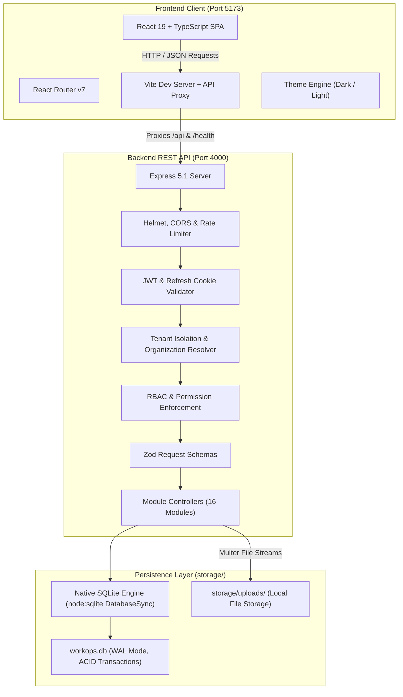
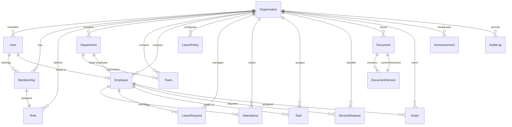

# WorkOps — Multi-Tenant Employee Operations SaaS Platform

[](https://nodejs.org/)
[](https://react.dev/)
[](https://www.typescriptlang.org/)
[](https://www.sqlite.org/)
[](https://expressjs.com/)
[](LICENSE)

> A modern, end-to-end multi-tenant **Employee Operations SaaS** designed to unify workplace operations into one auditable workspace. Built with Node.js 22, Express 5, React 19, TypeScript.

---

## Table of Contents

- [1. Executive Summary](#1-executive-summary)
- [2. Problem Statement & Value Proposition](#2-problem-statement--value-proposition)
- [3. System Architecture](#3-system-architecture)
  - [3.1 High-Level Architecture](#31-high-level-architecture)
  - [3.2 Data Flow & Request Lifecycle](#32-data-flow--request-lifecycle)
  - [3.3 Multi-Tenant Isolation Model](#33-multi-tenant-isolation-model)
- [4. Core Features & Functional Modules](#4-core-features--functional-modules)
  - [4.1 Identity, Authentication & Session Security](#41-identity-authentication--session-security)
  - [4.2 Employee Directory & Organizational Hierarchy](#42-employee-directory--organizational-hierarchy)
  - [4.3 Attendance Tracking & Work-Hour Logging](#43-attendance-tracking--work-hour-logging)
  - [4.4 Leave Management & Approval Workflows](#44-leave-management--approval-workflows)
  - [4.5 Operational Tasks & Productivity Board](#45-operational-tasks--productivity-board)
  - [4.6 Internal Service Requests & Helpdesk](#46-internal-service-requests--helpdesk)
  - [4.7 Document Management & File Versioning](#47-document-management--file-versioning)
  - [4.8 Physical Asset Registry & Lifecycle Tracking](#48-physical-asset-registry--lifecycle-tracking)
  - [4.9 Announcements, Calendar & Notifications](#49-announcements-calendar--notifications)
  - [4.10 Analytics, KPI Reporting & Dashboard](#410-analytics-kpi-reporting--dashboard)
  - [4.11 Organization Settings & Audit Logging](#411-organization-settings--audit-logging)
- [5. Role-Based Access Control (RBAC)](#5-role-based-access-control-rbac)
  - [5.1 User Roles](#51-user-roles)
  - [5.2 Permissions Matrix](#52-permissions-matrix)
- [6. Technology Stack](#6-technology-stack)
- [7. Project Folder Structure](#7-project-folder-structure)
- [8. Database Design & Entity Relationships](#8-database-design--entity-relationships)
  - [8.1 Entity Relationship Diagram (ERD)](#81-entity-relationship-diagram-erd)
  - [8.2 Native SQLite Engine Architecture](#82-native-sqlite-engine-architecture)
- [9. REST API Specification](#9-rest-api-specification)
  - [9.1 Global Headers & Protocols](#91-global-headers--protocols)
  - [9.2 Authentication Endpoints](#92-authentication-endpoints)
  - [9.3 Dashboard Endpoints](#93-dashboard-endpoints)
  - [9.4 Employee Endpoints](#94-employee-endpoints)
  - [9.5 Attendance Endpoints](#95-attendance-endpoints)
  - [9.6 Leave Endpoints](#96-leave-endpoints)
  - [9.7 Task Endpoints](#97-task-endpoints)
  - [9.8 Service Request Endpoints](#98-service-request-endpoints)
  - [9.9 Document Endpoints](#99-document-endpoints)
  - [9.10 Asset Endpoints](#910-asset-endpoints)
  - [9.11 Announcements & Notifications Endpoints](#911-announcements--notifications-endpoints)
  - [9.12 Reporting & Audit Endpoints](#912-reporting--audit-endpoints)
- [10. Prerequisites & Quickstart Guide](#10-prerequisites--quickstart-guide)
  - [10.1 System Requirements](#101-system-requirements)
  - [10.2 Installation Steps](#102-installation-steps)
  - [10.3 Database Seeding & Demo Credentials](#103-database-seeding--demo-credentials)
  - [10.4 Starting the Application](#104-starting-the-application)
- [11. Environment Configuration](#11-environment-configuration)
- [12. Testing & Quality Assurance](#12-testing--quality-assurance)
- [13. Security & Compliance Architecture](#13-security--compliance-architecture)
- [14. Production Deployment](#14-production-deployment)
  - [14.1 Docker & Containerization](#141-docker--containerization)
  - [14.2 Reverse Proxy Configuration (Nginx)](#142-reverse-proxy-configuration-nginx)
- [15. Troubleshooting & Frequently Asked Questions](#15-troubleshooting--frequently-asked-questions)
- [16. Product Roadmap](#16-product-roadmap)
- [17. License & Credits](#17-license--credits)

---

## 1. Executive Summary

**WorkOps** is an enterprise-oriented, multi-tenant software-as-a-service (SaaS) application that consolidates core day-to-day employee operations—workforce directory, clock-in/out attendance, leave requests, internal ticketing, operational task boards, versioned document storage, company asset assignment, announcements, real-time notifications, and immutable audit logs—into a centralized platform.

Engineered with a **zero-external-database-dependency** architecture by default, WorkOps runs out-of-the-box on Node.js 22 using an embedded, WAL-mode SQLite database with document-relational indexing. It eliminates the operational overhead of spinning up heavy database clusters during local development, internal enterprise trials, and resource-constrained on-premise environments, while remaining architecturally ready for scale.

```
┌────────────────────────────────────────────────────────────────────────┐
│                                WORKOPS                                 │
│                                                                        │
│   [ Employees ]   [ Attendance ]   [ Leave Approval ]   [ Tasks ]      │
│   [ Documents ]   [ Assets ]       [ Service Tickets]   [ Audit Logs ] │
│                                                                        │
│   ⚡ Native SQLite (Zero Config)   🔒 Strict Multi-Tenant RBAC         │
│   🎯 Vite + React 19 Frontend       🛡️ Express 5 Secure REST API       │
└────────────────────────────────────────────────────────────────────────┘
```

---

## 2. Problem Statement & Value Proposition

### The Problem
Growing organizations frequently manage employee operations across disconnected spreadsheets, unstructured email chains, shared cloud folders, and siloed single-purpose SaaS tools. This fragmentation causes:
- **Approval Bottlenecks:** Leave requests and equipment tickets get lost in email threads.
- **Tenant Data Leakage:** Ad-hoc tools lack rigorous tenant isolation controls for multi-branch organizations.
- **Compliance Exposure:** Missing audit trails for sensitive profile changes, document downloads, and asset reassignments.
- **Inflated Operational Costs:** Paying separate per-seat licenses for attendance trackers, ticketing desks, asset registries, and document stores.

### The Solution: WorkOps Value Proposition
1. **Single Source of Truth:** Centralizes personnel profiles, equipment tracking, document compliance, and daily workflows into one coordinated workspace.
2. **Deterministic Tenant Isolation:** Every request is authenticated, checked against active organization memberships, and strictly scoped by `organizationId`.
3. **Instant Portability & Zero-Hassle Deployment:** The embedded SQLite database engine ensures that the entire full-stack application can be launched in seconds on any developer machine or private cloud VM without running Docker daemons or external database services.
4. **Extensible Architecture:** Decoupled frontend and REST backend boundaries allow seamless addition of future automation workflows, webhooks, and local AI integrations without vendor lock-in.

---

## 3. System Architecture

### 3.1 High-Level Architecture

WorkOps utilizes a decoupled single-page application (SPA) and REST API architecture.



### 3.2 Data Flow & Request Lifecycle

1. **Client Request:** The user triggers an action in the React UI (e.g., submitting a leave request).
2. **Client Authentication:** The client injects the `Authorization: Bearer <accessToken>` header and optionally the `X-Organization-Id: <orgId>` header.
3. **Security Middleware:** 
   - `helmet` applies strict HTTP security headers (CSP, frameguards, XSS prevention).
   - `cors` verifies request origin against `CLIENT_URL`.
   - `rateLimit` throttles traffic per IP address (1,000 req/15m in dev, 300 in prod).
4. **Authentication & Tenant Resolution:**
   - `requireAuth` decodes and verifies the JWT against `JWT_ACCESS_SECRET`.
   - The token payload binds the request to `req.auth = { userId, organizationId, membershipId, role }`.
5. **Authorization (RBAC):** `requirePermission(permissionKey)` verifies that the user's assigned role possesses the requisite privilege.
6. **Input Validation:** Zod schemas validate `req.params`, `req.query`, and `req.body`.
7. **Business Logic Execution:** The relevant controller method invokes data operations scoped to `organizationId`.
8. **Audit Logging:** Sensitive mutations automatically write an event to the `audit_logs` SQLite table.
9. **Structured Response:** A standardized JSON envelope (`{ success: true, data: ... }`) is returned to the client.

### 3.3 Multi-Tenant Isolation Model

WorkOps strictly enforces tenant boundary isolation server-side:
- **Tenant Keys:** Every business entity in the database contains an `organizationId` foreign key.
- **Context Overrides:** Request bodies are never trusted for `organizationId`. The active organization is derived exclusively from the authenticated JWT session or verified via active organization membership when multi-tenant switching is requested.
- **Database Query Scoping:** All queries automatically inject `WHERE organization_id = ?`.

---

## 4. Core Features & Functional Modules

### 4.1 Identity, Authentication & Session Security
- **Dual-Token Authentication:** Employs short-lived JWT access tokens (15-minute default) paired with long-lived, HttpOnly, secure refresh tokens (7-day default) stored in the `workops_refresh` cookie.
- **Automatic Token Rotation:** The `/api/v1/auth/refresh` endpoint exchanges a valid refresh cookie for a fresh access token without user interruption.
- **Organization Onboarding:** The `/api/v1/auth/register` endpoint initializes an Organization, provisions default Owner/Admin/Manager/Employee roles, registers the administrator User, links them via a Membership record, and issues authentication tokens in a single atomic transaction.
- **Multi-Organization Switching:** Users belonging to multiple companies can switch workspace contexts via `/api/v1/auth/switch-organization`.

### 4.2 Employee Directory & Organizational Hierarchy
- **Auto-Generated Employee Codes:** Sequential identifiers generated per tenant (e.g., `EMP-0001`, `EMP-0002`).
- **Comprehensive Profiles:** Records employment type (full-time, part-time, contractor, intern), work mode (office, hybrid, remote), location, department, team, direct manager, and contact information.
- **Department & Team Structuring:** Tiered structure allowing departments to appoint head employees and create designated sub-teams.
- **Lifecycle Status Management:** Soft-deactivation workflow (`status: "inactive"`) preserving historical records, attendance history, and audit compliance.

### 4.3 Attendance Tracking & Work-Hour Logging
- **Daily Clock-In / Clock-Out:** One-click attendance recording with automatic timestamp tracking.
- **Automatic Work Duration Calculation:** Computes total active work minutes upon clock-out.
- **Administrative Adjustments:** Authorized personnel (`attendance.manage`) can upsert or adjust attendance logs across the workforce.
- **Attendance Insights:** Real-time workforce distribution calculations (`present`, `remote`, `late`, `absent`).

### 4.4 Leave Management & Approval Workflows
- **Configurable Leave Policies:** Supports unlimited custom policy types (Annual, Sick, Personal, Maternity, etc.) with configurable annual allowances, carry-forward toggles, and approval requirements.
- **Leave Request Lifecycle:** Multi-stage workflow (`pending` $\rightarrow$ `approved` / `rejected` / `cancelled`).
- **Manager Approval Actions:** Managers review requests with optional rejection reason logging, triggering immediate in-app notifications to the employee.
- **Date Range Validations:** Prevents submission of negative date spans or conflicting intervals.

### 4.5 Operational Tasks & Productivity Board
- **Task Delegation:** Direct task assignment linking assignee, reporter, priority (`low`, `medium`, `high`, `urgent`), and due dates.
- **Status State Machine:** Moves seamlessly through `todo` $\rightarrow$ `in_progress` $\rightarrow$ `completed` $\rightarrow$ `blocked`.
- **Assignee & Reporter Filtering:** Filter tasks specifically by individual contributor or organizational status.

### 4.6 Internal Service Requests & Helpdesk
- **Category-Based Ticketing:** Internal employee requests across Equipment, Access Cards, Work-From-Home approvals, and HR documents.
- **Threaded Comment Conversations:** Embedded discussion history on every ticket (`comments` array with author timestamps).
- **Priority Escalation:** Ticket triage with priority classification (`low`, `medium`, `high`, `urgent`) and direct employee assignment.

### 4.7 Document Management & File Versioning
- **Private Document Vault:** Controlled file repository for employee contracts, company handbooks, and policy templates.
- **Document Version Control:** The `DocumentVersion` entity retains past revisions, file sizes, MIME types, and upload notes when a document is updated.
- **Private Streamed Downloads:** Uploaded files stored outside the public web root (`storage/uploads/`); downloads are streamed strictly through authenticated endpoint checks.

### 4.8 Physical Asset Registry & Lifecycle Tracking
- **Hardware & Equipment Inventory:** Tracking for laptops, monitors, mobile phones, and accessories.
- **Assignment & Custody Tracking:** Logs current custodian (`assignedTo`), date assigned, return history, and equipment condition (`Excellent`, `Good`, `Fair`, `Damaged`).
- **Status Toggles:** Manages transition between `available`, `assigned`, `maintenance`, and `retired`.

### 4.9 Announcements, Calendar & Notifications
- **Broadcast Announcements:** Tenant-wide announcements with category filtering, publish timestamps, and automatic inbox notification dispatch to all active staff.
- **Shared Operational Calendar:** Shared tracking for company milestones, team sprints, town halls, and statutory holidays.
- **In-App Notification Feed:** Notification alerts for ticket assignments, leave reviews, and announcements, with single-item and bulk read status marking.

### 4.10 Analytics, KPI Reporting & Dashboard
- **Executive Summary Endpoint:** Aggregates present workforce headcount, employees on leave, pending requests, open tasks, and recent announcements in a single payload.
- **Departmental Workforce Reports:** Status breakdown and distribution analytics.
- **Aggregated Attendance & Leave Analytics:** Date-grouped aggregation pipelines computing total logged work hours and leave consumption metrics.

### 4.11 Organization Settings & Audit Logging
- **Workspace Customization:** Configurable work weeks (`[1, 2, 3, 4, 5]`), business operating hours (`09:00` to `18:00`), grace periods, and company timezone (`Asia/Dubai`).
- **Immutable Audit Trail:** Automated logging for security actions (`created`, `updated`, `deleted`, `approved`, `clocked_in`) capturing actor user ID, client IP address, target entity, and mutation details.

---

## 5. Role-Based Access Control (RBAC)

### 5.1 User Roles

| Role | Scope & Purpose |
| :--- | :--- |
| **Owner** | Primary organization stakeholder. Holds full administrative control, workspace settings access, audit log visibility, and subscription controls. |
| **Admin** | Operations administrator. Manages employees, departments, leave policies, assets, and settings. |
| **Manager** | Departmental / team lead. Reviews and approves leave requests, oversees tasks, resolves service tickets, and inspects team reports. |
| **Employee** | Standard workforce contributor. Manages personal attendance, submits leave requests, logs tickets, completes assigned tasks, and accesses shared resources. |

### 5.2 Permissions Matrix

| Permission Key | Owner | Admin | Manager | Employee |
| :--- | :---: | :---: | :---: | :---: |
| `employee.read` | ✅ | ✅ | ✅ | ✅ |
| `employee.create` / `update` / `delete` | ✅ | ✅ | ❌ | ❌ |
| `attendance.read` | ✅ | ✅ | ✅ | ✅ |
| `attendance.manage` (Admin upsert) | ✅ | ✅ | ❌ | ❌ |
| `leave.read` | ✅ | ✅ | ✅ | ✅ |
| `leave.create` | ✅ | ✅ | ✅ | ✅ |
| `leave.approve` | ✅ | ✅ | ✅ | ❌ |
| `leave.manage` (Policy creation) | ✅ | ✅ | ❌ | ❌ |
| `task.read` | ✅ | ✅ | ✅ | ✅ |
| `task.create` / `update` | ✅ | ✅ | ✅ | ✅ |
| `task.delete` | ✅ | ✅ | ❌ | ❌ |
| `request.read` / `create` | ✅ | ✅ | ✅ | ✅ |
| `request.manage` | ✅ | ✅ | ✅ | ❌ |
| `document.read` / `upload` | ✅ | ✅ | ✅ | ✅ |
| `document.manage` | ✅ | ✅ | ❌ | ❌ |
| `asset.read` | ✅ | ✅ | ✅ | ✅ |
| `asset.manage` | ✅ | ✅ | ❌ | ❌ |
| `announcement.read` | ✅ | ✅ | ✅ | ✅ |
| `announcement.manage` | ✅ | ✅ | ✅ | ❌ |
| `calendar.read` | ✅ | ✅ | ✅ | ✅ |
| `calendar.manage` | ✅ | ✅ | ✅ | ❌ |
| `report.read` | ✅ | ✅ | ✅ | ❌ |
| `audit.read` | ✅ | ✅ | ❌ | ❌ |
| `settings.read` | ✅ | ✅ | ❌ | ❌ |
| `settings.manage` | ✅ | ✅ | ❌ | ❌ |
| `user.manage` (Invite & Role modification) | ✅ | ✅ | ❌ | ❌ |

---

## 6. Technology Stack

```
Frontend:
  React 19.0 (Hooks, Context, Modern Concurrent Mode)
  TypeScript 5.9 (Strict Type Checking)
  Vite 8.3 (High-Speed ESM Bundler & Dev Proxy)
  React Router DOM 7.3 (Client-side Routing & Route Guards)
  Lucide React (Clean, Accessible Iconography)
  Custom CSS Design System (Glassmorphic, Theme Tokens, Responsive Grid)

Backend:
  Node.js 22.14 LTS (Native node:sqlite Support)
  Express 5.1 (Routing & Middleware Pipeline)
  TypeScript 5.9 (NodeNext Module Resolution)
  Zod 4.1 (Request Schema Parsing & Validation)
  JSONWebToken 9.0 (Stateless Access & Refresh Token Signing)
  Bcryptjs 2.4 (Salted Password Hashing, 12 Rounds)
  Pino 9.9 & Pino-HTTP 10.5 (High-Performance Structured JSON Logging)
  Helmet 8.1 (HTTP Security Headers)
  CORS 2.8 (Cross-Origin Resource Policy)
  Express Rate Limit 7.5 (DDoS & Brute Force Protection)
  Multer 2.0 (Multipart File Stream Uploads)

Persistence:
  Embedded SQLite (Built-in Node 22 DatabaseSync Engine)
  WAL (Write-Ahead Logging) Mode with Foreign Keys & Immediate Transactions
  Local Disk Storage (storage/uploads/ for private document versions)

Quality & DevOps:
  Vitest 3.2 (Unit & Integration Testing)
  Docker & Docker Compose (Multi-stage Containerization)
```

---

## 7. Project Folder Structure

```text
workops/
├── README.md                           # Master Project Documentation
├── readme.md                           # Original Project Overview & Resume Notes
│
├── workops-backend/                    # Express 5 REST API & SQLite Engine
│   ├── Dockerfile                      # Production Multi-Stage Container Definition
│   ├── docker-compose.yml              # Container Orchestration Specification
│   ├── package.json                    # Backend Dependencies & Scripts
│   ├── tsconfig.json                   # Strict TypeScript Compiler Configuration
│   ├── .env                            # Active Backend Environment Variables
│   ├── .env.example                    # Sample Environment Template
│   │
│   ├── docs/
│   │   └── API.md                      # Supplementary Endpoint Catalog
│   │
│   ├── storage/                        # Persistent Application Data (Ignored in Git)
│   │   ├── workops.db                  # Live SQLite Database File (WAL Mode)
│   │   └── uploads/                    # Secure Staged File Uploads
│   │
│   └── src/
│       ├── app.ts                      # Express Application Assembly & Route Mounting
│       ├── server.ts                   # HTTP Server Initialization & Graceful Shutdown
│       ├── seed.ts                     # Database Seeder (Demo Workspace Setup)
│       │
│       ├── config/
│       │   ├── env.ts                  # Validated Environment Variable Map
│       │   ├── db.ts                   # SQLite Connection Lifecycle Initiator
│       │   └── logger.ts               # Pino Structured Logger Configuration
│       │
│       ├── sqlite/
│       │   └── index.ts                # Custom SQLite Engine (DatabaseSync ODM, Query, Aggregates)
│       │
│       ├── models/                     # 20 SQLite Document/Relational Entity Models
│       │   ├── Announcement.ts
│       │   ├── Asset.ts
│       │   ├── Attendance.ts
│       │   ├── AuditLog.ts
│       │   ├── CalendarEvent.ts
│       │   ├── Department.ts
│       │   ├── Document.ts
│       │   ├── DocumentVersion.ts
│       │   ├── Employee.ts
│       │   ├── Invite.ts
│       │   ├── LeavePolicy.ts
│       │   ├── LeaveRequest.ts
│       │   ├── Membership.ts
│       │   ├── Notification.ts
│       │   ├── Organization.ts
│       │   ├── Role.ts
│       │   ├── ServiceRequest.ts
│       │   ├── Task.ts
│       │   ├── Team.ts
│       │   └── User.ts
│       │
│       ├── controllers/                # 16 Business Logic Controllers
│       ├── routes/                     # 17 REST API Route Definitions
│       ├── middlewares/                # Auth, Permission, Validation & Error Handlers
│       ├── validators/                 # Zod Request Validation Schemas
│       ├── services/                   # Auth, Audit, Invite & Notification Services
│       ├── utils/                      # JWT, Crypto, Pagination & Permission Helpers
│       └── tests/                      # Vitest Automated Test Suites
│
└── workops-frontend/                   # React 19 + TypeScript SPA
    ├── index.html                      # HTML5 Shell & Meta Configuration
    ├── package.json                    # Frontend Dependencies & Scripts
    ├── vite.config.ts                  # Vite Bundler & Reverse Proxy Configuration
    ├── tsconfig.json                   # Root TypeScript Project References
    ├── tsconfig.app.json               # Application TypeScript Compiler Settings
    ├── tsconfig.node.json              # Node Environment TypeScript Settings
    ├── .env                            # Frontend Environment Configuration
    ├── .env.example                    # Sample Frontend Environment Template
    │
    └── src/
        ├── main.tsx                    # React DOM Mounting Entry Point
        ├── App.tsx                     # Top-Level Router & Layout Resolver
        ├── styles.css                  # Master CSS Design System & Theme Styles
        │
        ├── components/
        │   ├── layout/                 # AppLayout, PublicLayout, Sidebar, Topbar
        │   └── ui/                     # Reusable Buttons, Cards, Modals, Badges, Tables
        │
        ├── pages/                      # 18 Application Views
        │   ├── Landing.tsx             # Marketing Homepage
        │   ├── Login.tsx               # Workspace Sign-In
        │   ├── Register.tsx            # Company Registration
        │   ├── Dashboard.tsx           # Operational Overview & KPI Summary
        │   ├── Employees.tsx           # Employee Directory & Creation Modal
        │   ├── EmployeeDetail.tsx      # Comprehensive Employee Profile
        │   ├── Attendance.tsx          # Clock-In/Out & Shift Records
        │   ├── Leave.tsx               # Leave Balance & Approval Workflows
        │   ├── Tasks.tsx               # Task Board & Delegation View
        │   ├── Requests.tsx            # Helpdesk Service Tickets
        │   ├── Documents.tsx           # Private Document Repository
        │   ├── Assets.tsx              # Hardware & Inventory Tracking
        │   ├── Announcements.tsx       # Company News & Alerts
        │   ├── CalendarPage.tsx        # Events & Operational Schedule
        │   ├── Reports.tsx             # Workforce & Attendance Reports
        │   ├── Notifications.tsx       # User Notification Feed
        │   ├── AuditLogs.tsx           # Compliance Audit Log Viewer
        │   ├── Help.tsx                # Documentation & Support Center
        │   └── settings/               # Workspace Settings (Organization, Members)
        │
        ├── data/
        │   └── mockData.ts             # Client-side Demo Data Models
        └── lib/
            └── utils.ts                # Utility Formatters & Class Helpers
```

---

## 8. Database Design & Entity Relationships

### 8.1 Entity Relationship Diagram (ERD)



### 8.2 Native SQLite Engine Architecture

WorkOps utilizes Node 22's built-in `node:sqlite` (`DatabaseSync`), configured in [src/sqlite/index.ts](file:///c:/Users/mhdni/OneDrive/Desktop/workops/workops-backend/src/sqlite/index.ts):

1. **Table Structure:** Each of the 20 models maps to a dedicated SQLite table:
   ```sql
   CREATE TABLE IF NOT EXISTS {tableName} (
     id TEXT PRIMARY KEY,
     organization_id TEXT,
     created_at TEXT,
     updated_at TEXT,
     data TEXT NOT NULL
   );
   CREATE INDEX IF NOT EXISTS idx_{tableName}_org ON {tableName}(organization_id);
   CREATE INDEX IF NOT EXISTS idx_{tableName}_created ON {tableName}(created_at);
   ```
2. **Document-Relational Hybrid:** The full JSON document is preserved in the `data` column, while indexing critical relational fields (`id`, `organization_id`, `created_at`). Virtual expression indexes are applied to critical unique keys:
   ```sql
   CREATE INDEX IF NOT EXISTS idx_users_email ON users(json_extract(data, '$.email'));
   CREATE INDEX IF NOT EXISTS idx_orgs_slug ON organizations(json_extract(data, '$.slug'));
   ```
3. **Write-Ahead Logging (WAL):** Enabled via `PRAGMA journal_mode = WAL;`, allowing concurrent read operations without blocking active write transactions.
4. **Immediate Transactions:** `withTransaction()` wraps multi-entity operations in `BEGIN IMMEDIATE;` and `COMMIT;` blocks, guaranteeing ACID guarantees during registration and approvals.

---

## 9. REST API Specification

### 9.1 Global Headers & Protocols

- **Base URL:** `http://localhost:4000/api/v1`
- **Content-Type:** `application/json` (except multipart document uploads)
- **Authorization:** `Authorization: Bearer <accessToken>`
- **Tenant Context Switch (Optional):** `X-Organization-Id: <organizationId>`

---

### 9.2 Authentication Endpoints

#### `POST /auth/register`
Creates a new tenant workspace and root user.

**Request Body:**
```json
{
  "firstName": "Nibras",
  "lastName": "Admin",
  "email": "nibras@company.com",
  "password": "StrongPassword123!",
  "companyName": "Acme Innovations"
}
```

**Response (201 Created):**
```json
{
  "success": true,
  "data": {
    "user": {
      "_id": "5198e026a6bd4f6cdf84e9fd",
      "email": "nibras@company.com",
      "firstName": "Nibras",
      "lastName": "Admin",
      "status": "active"
    },
    "organization": {
      "_id": "3975531d4e3bb31ea2c90561",
      "name": "Acme Innovations",
      "slug": "acme-innovations-k8f9a2"
    },
    "accessToken": "eyJhbGciOiJIUzI1NiIsInR5cCI6IkpXVCJ9..."
  }
}
```

#### `POST /auth/login`
Authenticates a user, issues an access token, and sets the HttpOnly refresh cookie.

**Request Body:**
```json
{
  "email": "admin@workops.local",
  "password": "Admin@12345"
}
```

**Response (200 OK):**
```json
{
  "success": true,
  "data": {
    "user": {
      "_id": "5198e026a6bd4f6cdf84e9fd",
      "email": "admin@workops.local",
      "firstName": "Nibras",
      "lastName": "Admin",
      "status": "active"
    },
    "organization": {
      "_id": "3975531d4e3bb31ea2c90561",
      "name": "WorkOps Demo",
      "slug": "workops-demo"
    },
    "accessToken": "eyJhbGciOiJIUzI1NiIsInR5cCI6IkpXVCJ9..."
  }
}
```
*Note: A `Set-Cookie: workops_refresh=...; HttpOnly; SameSite=Lax` header is returned automatically.*

#### `POST /auth/refresh`
Rotates access tokens using the refresh cookie or optional body parameter.

#### `GET /auth/me`
Fetches the current user profile, organization, active membership, and associated permissions.

---

### 9.3 Dashboard Endpoints

#### `GET /dashboard/summary`
Returns top-level workspace metrics for the dashboard.

**Response (200 OK):**
```json
{
  "success": true,
  "data": {
    "employees": 128,
    "present": 104,
    "onLeave": 12,
    "leavePending": 7,
    "requestsPending": 4,
    "tasksOpen": 18,
    "announcements": []
  }
}
```

---

### 9.4 Employee Endpoints

| Method | Endpoint | Description | Permission Required |
| :--- | :--- | :--- | :--- |
| `GET` | `/employees` | List paginated employees with filter queries (`search`, `departmentId`, `status`) | `employee.read` |
| `POST` | `/employees` | Create a new employee record and assign sequential code | `employee.create` |
| `GET` | `/employees/:id` | Fetch comprehensive employee profile with relations | `employee.read` |
| `PATCH` | `/employees/:id` | Update employee information | `employee.update` |
| `DELETE`| `/employees/:id` | Soft-deactivate employee record (`status: "inactive"`) | `employee.delete` |

---

### 9.5 Attendance Endpoints

| Method | Endpoint | Description |
| :--- | :--- | :--- |
| `GET` | `/attendance/today` | Fetch logged attendance for current user for today |
| `POST` | `/attendance/clock-in` | Record clock-in timestamp |
| `POST` | `/attendance/clock-out` | Record clock-out timestamp and calculate total minutes |
| `GET` | `/attendance` | List workforce attendance records across date filters |
| `POST` | `/attendance/admin` | Administratively upsert/adjust an employee attendance log |

---

### 9.6 Leave Endpoints

| Method | Endpoint | Description |
| :--- | :--- | :--- |
| `GET` | `/leave/policies` | List all organization leave policies |
| `POST` | `/leave/policies` | Create a leave policy (`annualAllowance`, `carryForward`) |
| `GET` | `/leave/requests` | List leave requests filtered by status or employee |
| `POST` | `/leave/requests` | Submit a new leave request |
| `POST` | `/leave/requests/:id/review` | Approve or reject a leave request (`action: "approve" \| "reject"`) |
| `POST` | `/leave/requests/:id/cancel` | Cancel a pending leave request |

---

### 9.7 Task Endpoints

| Method | Endpoint | Description |
| :--- | :--- | :--- |
| `GET` | `/tasks` | List organization tasks (`status`, `assigneeId`) |
| `POST` | `/tasks` | Create a task with priority and due date |
| `GET` | `/tasks/:id` | Retrieve task details |
| `PATCH` | `/tasks/:id` | Update task progress or reassign |
| `DELETE`| `/tasks/:id` | Delete an operational task |

---

### 9.8 Service Request Endpoints

| Method | Endpoint | Description |
| :--- | :--- | :--- |
| `GET` | `/requests` | List internal service tickets |
| `POST` | `/requests` | Create a ticket (`title`, `category`, `priority`) |
| `PATCH` | `/requests/:id` | Update ticket status, assignee, or append conversation comment |

---

### 9.9 Document Endpoints

| Method | Endpoint | Description |
| :--- | :--- | :--- |
| `GET` | `/documents` | List company documents |
| `POST` | `/documents/upload` | Upload document file via multipart/form-data |
| `GET` | `/documents/:id` | Get document metadata and active version info |
| `GET` | `/documents/:id/download` | Stream and download private file attachment |
| `GET` | `/documents/:id/versions` | List historical revision history for a document |

---

### 9.10 Asset Endpoints

| Method | Endpoint | Description |
| :--- | :--- | :--- |
| `GET` | `/assets` | List physical assets with assignment status |
| `POST` | `/assets` | Register hardware/inventory (`serialNumber`, `type`) |
| `POST` | `/assets/:id/assign` | Assign asset to an employee |
| `POST` | `/assets/:id/return` | Process asset return and update condition |

---

### 9.11 Announcements & Notifications Endpoints

| Method | Endpoint | Description |
| :--- | :--- | :--- |
| `GET` | `/announcements` | List published company announcements |
| `POST` | `/announcements` | Publish announcement & trigger inbox notifications |
| `GET` | `/notifications` | List user in-app notifications |
| `PATCH`| `/notifications/:id/read` | Mark individual notification as read |
| `POST` | `/notifications/read-all`| Mark all user notifications as read |

---

### 9.12 Reporting & Audit Endpoints

| Method | Endpoint | Description |
| :--- | :--- | :--- |
| `GET` | `/reports/overview` | Aggregated employee, attendance, task, and ticket distributions |
| `GET` | `/reports/attendance`| Date-grouped workforce hours and status counts |
| `GET` | `/reports/leave` | Company-wide leave utilization breakdowns |
| `GET` | `/audit-logs` | Immutable system audit log entries |

---

## 10. Prerequisites & Quickstart Guide

### 10.1 System Requirements
- **Node.js:** `v22.11.0` or higher (Node 22 LTS recommended for built-in `node:sqlite` support)
- **Package Manager:** `npm` v10+
- **Operating System:** Windows 10/11, macOS, or Linux
- **No external database server (MongoDB, PostgreSQL, MySQL) is required!**

---

### 10.2 Installation Steps

#### Step 1: Install Backend Dependencies
```bash
cd workops-backend
npm install
```

#### Step 2: Install Frontend Dependencies
```bash
cd ../workops-frontend
npm install
```

---

### 10.3 Database Seeding & Demo Credentials

The backend comes with an automated seed script that initializes an organization, departments, teams, policies, sample assets, and an administrative account into the SQLite database.

Execute from the `workops-backend` folder:
```bash
npm run seed
```

Output:
```text
SQLite database connected: ./storage/workops.db
WorkOps demo seeded.

Email: admin@workops.local
Password: Admin@12345
Organization: 3975531d4e3bb31ea2c90561
```

---

### 10.4 Starting the Application

#### Terminal 1 — Start the Backend API (Port 4000)
```bash
cd workops-backend
npm start
```
*(Alternatively, for hot-reloading development: `npm run dev`)*

Verify backend health in your browser or terminal:
```bash
curl http://localhost:4000/health
```
Expected output:
```json
{
  "success": true,
  "data": {
    "status": "ok",
    "database": "connected",
    "engine": "SQLite",
    "timestamp": "2026-10-09T17:44:00.387Z"
  }
}
```

#### Terminal 2 — Start the Frontend UI (Port 5173)
```bash
cd workops-frontend
npm run dev
```

Open your browser to: **`http://localhost:5173`**

Log in with:
- **Email:** `admin@workops.local`
- **Password:** `Admin@12345`

---

## 11. Environment Configuration

### Backend Configuration (`workops-backend/.env`)

| Variable | Description | Required? | Default / Example Value |
| :--- | :--- | :---: | :--- |
| `NODE_ENV` | Application environment mode | No | `development` |
| `PORT` | HTTP server port | No | `4000` |
| `SQLITE_PATH` | Path to the SQLite database file | No | `./storage/workops.db` |
| `JWT_ACCESS_SECRET` | Secret key for signing access tokens | Yes (in prod) | *Pre-configured secure dev secret* |
| `JWT_REFRESH_SECRET`| Secret key for signing refresh tokens | Yes (in prod) | *Pre-configured secure dev secret* |
| `ACCESS_TOKEN_TTL` | Access token lifespan | No | `15m` |
| `REFRESH_TOKEN_TTL`| Refresh token lifespan | No | `7d` |
| `CLIENT_URL` | Allowed CORS origins (comma-separated) | No | `http://localhost:5173` |
| `COOKIE_SECURE` | Set `true` if serving over HTTPS | No | `false` |
| `UPLOAD_DIR` | Local disk folder for file storage | No | `./storage/uploads` |
| `MAX_UPLOAD_MB` | Maximum allowed file upload size | No | `10` |
| `LOG_LEVEL` | Pino logger verbosity level | No | `info` |

### Frontend Configuration (`workops-frontend/.env`)

| Variable | Description | Required? | Default / Example Value |
| :--- | :--- | :---: | :--- |
| `VITE_API_BASE_URL` | Base URL for REST API communication | No | `http://localhost:4000/api/v1` |

---

## 12. Testing & Quality Assurance

WorkOps includes a pre-configured Vitest test runner.

### Running Backend Tests
```bash
cd workops-backend
npm test
```

### Running TypeScript Linting & Type Checking
```bash
cd workops-backend
npm run lint
```

### Verifying Frontend Production Build
```bash
cd workops-frontend
npm run build
```

---

## 13. Security & Compliance Architecture

1. **Password Security:** Passwords hashed with `bcryptjs` using a cost factor of 12 rounds. Plaintext passwords never touch logs or databases.
2. **Access Token Hardening:** Stateless JWTs contain minimal identifying payload (`sub`, `org`, `membership`, `role`), signed with HS256.
3. **Cookie Defenses:** Refresh tokens are isolated inside `HttpOnly`, `SameSite=Lax` cookies, preventing cross-site scripting (XSS) extraction.
4. **Input Sanitization:** Every API endpoint validates incoming input against strict Zod type boundaries, rejecting unrecognized payloads.
5. **Rate Limiting:** `express-rate-limit` prevents brute-force login attempts and denial-of-service abuse.
6. **Strict Tenant Scoping:** Every query evaluates the authenticated tenant context, preventing cross-organization data leakage.
7. **Comprehensive Audit Trails:** Mutations (creation, status reviews, deletes) write immutable event logs recording `actorId`, `action`, `entityType`, and client IP.

---

## 14. Production Deployment

### 14.1 Docker & Containerization

WorkOps includes a production multi-stage [Dockerfile](file:///c:/Users/mhdni/OneDrive/Desktop/workops/workops-backend/Dockerfile) for the backend.

Build and run using Docker:
```bash
cd workops-backend
docker build -t workops-backend:latest .
docker run -p 4000:4000 \
  -e NODE_ENV=production \
  -e SQLITE_PATH=/app/storage/workops.db \
  -v $(pwd)/storage:/app/storage \
  workops-backend:latest
```

### 14.2 Reverse Proxy Configuration (Nginx)

When deploying to a public VPS or cloud instance:

```nginx
server {
    listen 80;
    server_name workops.yourdomain.com;

    # Serve built React frontend
    location / {
        root /var/www/workops-frontend/dist;
        index index.html;
        try_files $uri $uri/ /index.html;
    }

    # Proxy REST API requests
    location /api/ {
        proxy_pass http://127.0.0.1:4000;
        proxy_http_version 1.1;
        proxy_set_header Host $host;
        proxy_set_header X-Real-IP $remote_addr;
        proxy_set_header X-Forwarded-For $proxy_add_x_forwarded_for;
        proxy_set_header X-Forwarded-Proto $scheme;
    }

    location /health {
        proxy_pass http://127.0.0.1:4000/health;
    }
}
```

---

## 15. Troubleshooting & Frequently Asked Questions

### 1. `Cannot find module 'node:sqlite'`
- **Cause:** You are running a Node.js version older than v22.11.0.
- **Solution:** Upgrade your Node runtime to Node.js v22 LTS or higher:
  ```bash
  node -v  # Ensure output is v22.11.0 or higher
  ```

### 2. `ExperimentalWarning: SQLite is an experimental feature`
- **Explanation:** This is standard informational output from Node.js indicating that the built-in SQLite module is active. It does not affect application stability or performance.

### 3. Port Conflict on 4000 or 5173
- **Cause:** Another process is utilizing port 4000 or 5173.
- **Solution:** Change the port in `workops-backend/.env` (`PORT=5000`) or pass a custom port to Vite (`npx vite --port 3000`).

### 4. Database Reset / Clean State
- **Solution:** To completely reset the SQLite database, delete the database file and re-seed:
  ```bash
  rm workops-backend/storage/workops.db
  cd workops-backend
  npm run seed
  ```

---

## 16. Product Roadmap

- [ ] **Webhook Infrastructure:** Outbound webhooks for leave approvals and employee onboarding events.
- [ ] **S3 / Cloudflare R2 Document Adapter:** Plug-and-play cloud object storage adapter for large enterprise document storage.
- [ ] **CSV / XLSX Bulk Importer:** Bulk employee onboarding spreadsheet import with column mapping.
- [ ] **Automated PDF Generation:** Direct client-side generation of employment verification letters.
- [ ] **Local AI Assistant Integration:** Support for self-hosted LLMs (via Ollama) for summarizing internal service requests and drafting company announcements.

---

## 17. License & Credits

This project is licensed under the **MIT License**.

Designed and maintained for high-efficiency modern employee operations. Built with Node.js, Express, React, and TypeScript.
